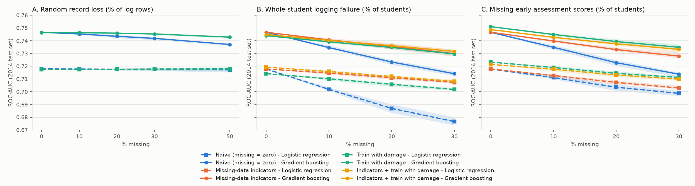
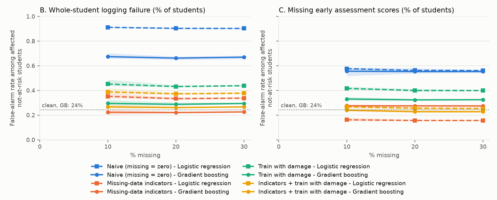

# Early-warning prediction when activity logs are incomplete: a leakage-safe study on OULAD

**Question.** If a student's learning-platform records are incomplete, how much worse does an early-warning model for failing or dropping out get, and what limits the damage?

**Short answer.** On clean data, gradient boosting reaches ROC-AUC **0.747 (95% CI 0.739 to 0.755)** at week 4 when trained on 2013 and tested on 2014. Losing random log rows barely matters. Losing *all* of a student's logs matters a lot. When logging fails for 30% of students, AUC falls to **0.716**, and the false-alarm rate among those students who actually passed rises from **24% to 68%** (to 90% for logistic regression). The model reads missing logs as a disengaged student. A missing-data flag brings their false-alarm rate back to **23%** and recovers AUC to **0.728**, about 40% of the AUC that was lost.



## Data

[Open University Learning Analytics Dataset (OULAD)](https://analyse.kmi.open.ac.uk/open_dataset): anonymised records of 32,593 student registrations across 7 modules and 22 module runs ("presentations") at the UK's Open University, released under CC-BY 4.0. The dataset isn't included in this repo; see [data/README.md](data/README.md) for how to download it.

> Kuzilek, J., Hlosta, M. & Zdrahal, Z. Open University Learning Analytics dataset. *Scientific Data* 4, 170171 (2017). https://doi.org/10.1038/sdata.2017.171

## Task

| | |
|---|---|
| Unit | one student in one module run |
| Label | **at risk = 1** if `final_result` is Withdrawn or Fail; **0** if Pass or Distinction |
| Prediction time | **day 28** (four weeks in); only data dated on or before day 28 is used |
| Excluded | students who unregistered on or before day 28 (5,055; they've already left), and students who registered after day 28 (16; not yet enrolled) |
| Rows kept | 27,522 (2013: 11,802, 2014: 15,720; about 44% at risk in both years) |

### Features (one row per student per module run; built in [`src/features.py`](src/features.py))

- **Background** (`studentInfo`, `studentRegistration`): age band, highest education, deprivation band (`imd_band`), disability, previous attempts, credits studied, registration date. **Gender is deliberately left out** for fairness. Region and module code are also left out, so the model can't simply learn which module runs have high failure rates.
- **Activity up to day 28** (`studentVle`, `vle`): total clicks; clicks in the pre-start period and in weeks 1 to 4 (days 0–6, 7–13, 14–20, 21–28); number of active days; number of distinct resources; clicks for the six most-clicked activity types in 2013 (forumng, homepage, oucontent, subpage, quiz, resource); days since last activity at day 28.
- **Assessments up to day 28** (`assessments`, `studentAssessment`): number submitted, mean score, number submitted late. Exams are excluded.

### Leakage rules and how they are enforced

Leakage means the model sees information it wouldn't have at prediction time.

1. `studentVle` is filtered to `date <= 28` **while it is read**, chunk by chunk, before any aggregation. An `assert` checks that the max date is 28.
2. Only assessments **submitted** by day 28 are used, and exams are dropped. Asserted.
3. The unregistration date is used only to exclude students. It's dropped from the table before features are built.
4. `final_result` only becomes the label. Notebook 01 asserts that none of the forbidden columns are among the features.
5. The six activity types are chosen from 2013 (training) students only.

**What leakage looks like here.** The same gradient-boosting model, given activity counted over the *whole* module run instead of up to day 28, scores **AUC 0.949** on 2014. That's the "suspiciously high" number to watch for. The honest day-28 model scores 0.747, between published honest figures for week 1 (about 0.72) and week 8 (about 0.86).

## Splits

- **Main split, by time:** train on all 2013 runs and test on all 2014 runs. This mirrors real use: a model built on last year and used this year, when course materials and cohorts have changed. Module CCC only runs in 2014, so the test set also includes a module the model has never seen.
- **Comparison split, random 80/20** stratified by label. It mixes the same module runs, cohorts and course designs into both training and testing, so it overstates how well the model will do on next year's students.

## Models and metrics ([`src/evaluate.py`](src/evaluate.py))

- **Baseline:** always predict the majority class (not at risk).
- **Logistic regression:** one-hot categories, log1p on click counts, standardised numeric features, `class_weight="balanced"`.
- **Gradient boosting:** scikit-learn `HistGradientBoostingClassifier` with native categorical and missing-value handling, default hyperparameters.

ROC-AUC is the headline metric. We also report PR-AUC, and precision, recall, F1 and the false-alarm rate for the at-risk class, plus a confusion matrix, all at threshold 0.5. The 95% CI for AUC comes from 1,000 bootstrap resamples of the test set.

### Clean-data results

| Split | Model | ROC-AUC [95% CI] | PR-AUC | Recall | Precision | F1 | False-alarm rate |
|---|---|---|---|---|---|---|---|
| time 2013→2014 | Majority class | 0.500 | 0.439 | 0.000 | – | 0.000 | 0.0% |
| time 2013→2014 | Logistic regression | 0.718 [0.710, 0.725] | 0.673 | 0.571 | 0.631 | 0.600 | 26.1% |
| time 2013→2014 | **Gradient boosting** | **0.747 [0.739, 0.755]** | 0.704 | 0.601 | 0.660 | 0.629 | 24.2% |
| random 80/20 | Logistic regression | 0.732 [0.719, 0.745] | 0.689 | 0.662 | 0.619 | 0.640 | 32.1% |
| random 80/20 | Gradient boosting | 0.775 [0.763, 0.787] | 0.750 | 0.606 | 0.702 | 0.650 | 20.3% |

The random split flatters gradient boosting by about 0.03 AUC. Confusion matrices are in [results/confusion_matrices.md](results/confusion_matrices.md). By permutation importance, the strongest feature is the mean early assessment score, followed by credits studied, highest education, active days and late submissions ([notebook 02](notebooks/02_baselines.ipynb)).

## The experiment: damaging the 2014 records ([`src/corrupt.py`](src/corrupt.py))

Models are trained on 2013. The raw 2014 records are damaged, and then features are rebuilt from the damaged records, the same way a real pipeline would compute them. Each damage level is run with 5 random seeds.

| Damage | How | Analogy |
|---|---|---|
| **A. Random record loss** | delete p% of `studentVle` rows, p = 0, 10, 20, 30, 50 | sensor readings dropped at random |
| **B. Whole-student logging failure** | delete all activity for q% of students, q = 0, 10, 20, 30 | a tank the sensor can't see: no data looks like no activity |
| **C. Missing assessment scores** | delete all early assessment records for q% of students | a field form never filed |

Handling strategies:

- **Naive:** features are rebuilt from whatever is left, so missing activity becomes zero clicks. This is what most systems do by default.
- **Missing-data indicators:** the affected values are set to missing (NaN) and a flag (`log_failed` / `scores_missing`) is added. *This assumes the system records its own logging failures.* Gradient boosting uses the NaNs directly; logistic regression imputes the training median. It doesn't apply to damage A, because random row loss can't be detected for any one student.
- **Train with damage:** the same type of damage is applied to the 2013 training data so the model sees what it looks like. For A, each training student gets a loss rate drawn from {0, 10, 20, 30, 50}%. For B and C, 15% of training students are affected.
- **Indicators + train with damage:** both of the above.

### Results: AUC [95% bootstrap CI] at 0% and 30% damage (seed 0)

False alarms are the share of students who went on to pass but were flagged at risk. The last column counts only the students whose records were lost; before damage, the same students had a 24% false-alarm rate with gradient boosting (26% with logistic regression).

| Damage | Strategy | Model | AUC at 0% | AUC at 30% | False alarms, all, 30% | False alarms, affected, 30% |
|---|---|---|---|---|---|---|
| A | Naive | Gradient boosting | 0.747 [0.739, 0.755] | 0.743 [0.734, 0.750] | 26.9% | – |
| A | Train with damage | Gradient boosting | 0.746 [0.738, 0.754] | 0.746 [0.738, 0.754] | 25.6% | – |
| A | Naive | Logistic regression | 0.718 [0.710, 0.725] | 0.718 [0.710, 0.726] | 27.3% | – |
| B | Naive | Gradient boosting | 0.747 [0.739, 0.755] | **0.716** [0.708, 0.725] | 37.1% | **67.9%** |
| B | Indicators | Gradient boosting | 0.747 [0.739, 0.755] | 0.728 [0.720, 0.736] | 23.9% | **23.1%** |
| B | Train with damage | Gradient boosting | 0.744 [0.736, 0.752] | 0.729 [0.721, 0.737] | 25.8% | 30.1% |
| B | Indicators + train with damage | Gradient boosting | 0.745 [0.737, 0.753] | 0.730 [0.722, 0.738] | 24.9% | 27.0% |
| B | Naive | Logistic regression | 0.718 [0.710, 0.725] | 0.680 [0.672, 0.688] | 45.2% | **90.8%** |
| B | Indicators | Logistic regression | 0.718 [0.710, 0.725] | 0.708 [0.699, 0.715] | 28.7% | 34.5% |
| C | Naive | Gradient boosting | 0.747 [0.739, 0.755] | 0.715 [0.707, 0.723] | 33.4% | 55.3% |
| C | Indicators | Gradient boosting | 0.747 [0.739, 0.755] | 0.728 [0.720, 0.736] | 25.3% | 27.7% |
| C | Train with damage | Gradient boosting | 0.751 [0.743, 0.758] | 0.736 [0.728, 0.743] | 26.8% | 32.8% |
| C | Indicators + train with damage | Gradient boosting | 0.749 [0.741, 0.756] | 0.735 [0.727, 0.742] | 24.0% | 22.1% |
| C | Naive | Logistic regression | 0.718 [0.710, 0.725] | 0.701 [0.693, 0.708] | 35.0% | 56.0% |
| C | Indicators | Logistic regression | 0.718 [0.710, 0.725] | 0.702 [0.694, 0.709] | 22.9% | 15.0% |

The full table, with every model and strategy, is in [results/auc_table.md](results/auc_table.md). All runs are in [results/damage_results.csv](results/damage_results.csv).



### What we found

1. **Random record loss (A) barely matters.** Even with half the log rows deleted, gradient-boosting AUC only falls from 0.747 to 0.737, and logistic regression doesn't move. Dropping rows at random scales everyone's counts down together, so students keep roughly the same ranking.
2. **Whole-student failure (B) looks like disengagement.** Only 1.0% of students who went on to pass had zero clicks by day 28, against 6.2% of at-risk students. So "no activity" is a strong at-risk signal, and a student whose logs failed is pushed straight into it. With naive handling, 68% of affected students who passed are flagged (gradient boosting), and 91% with logistic regression. Overall AUC drops less dramatically (0.747 to 0.716) because the other 70% of students are unaffected. The harm falls on the specific students whose records went missing.
3. **A missing-data flag works, if you have one.** Setting the values to missing and adding a flag brings false alarms for affected students back to 23%, the same as clean data, and AUC to 0.728. This works even though the model never saw a flagged student in training. scikit-learn's gradient boosting sends missing values that weren't seen during training down the branch with more training samples, so affected students are scored mostly on their background. That's the right thing to do, but it's a side effect of the implementation rather than something the model learned.
4. **Training with damage helps AUC about as much, but leaves more false alarms** (30% for gradient boosting under B), because without a flag the model can't tell "logging failed" from "genuinely inactive." It also costs a little clean-data AUC under B (0.744 vs 0.747).
5. **No strategy recovers fully.** At 30% damage under B or C, the best strategy still sits around 0.73, below the clean 0.747. Once the activity or score data is gone, it can't be rebuilt, and those students have to be predicted from their background alone.
6. **What didn't help:** for logistic regression, indicators did little for AUC under damage C (0.701 → 0.702). They did lower its false alarms (15%), but mostly because median imputation gives the affected students an average-to-good score.

## Limitations

- The indicator strategy assumes the platform knows when it failed to log a student. Many don't.
- Damage is simulated and independent of the outcome. Real logging failures may be linked to device, region or disability, which would make things worse, and possibly unfair.
- Assessment scores for work submitted by day 28 are treated as known at day 28. In reality, tutor-marked scores can take a few days to come back, so this is a mild optimistic bias.
- A single fixed threshold (0.5) is used throughout. Choosing a threshold by cost would change recall and false-alarm figures, though not AUC.
- Default hyperparameters, with no tuning. The point is the comparison between strategies, not the best possible score.
- Only one dataset, from one institution and two academic years.

## How to run

```bash
pip install -r requirements.txt
# put the OULAD CSVs in data/ (see data/README.md)
python -m src.experiments      # everything (several minutes on a laptop); writes results/
```

The notebooks are run from `notebooks/`:

- [01_explore.ipynb](notebooks/01_explore.ipynb): label, features and leakage checks
- [02_baselines.ipynb](notebooks/02_baselines.ipynb): clean-data models, both splits, confusion matrices, feature importance
- [03_missing_logs.ipynb](notebooks/03_missing_logs.ipynb): damage results, and a worked example of damage B

Memory: `studentVle.csv` is about 430 MB. It's read in chunks with int16/int32 types and filtered to day 28 on the fly (about 2.8M of 10.6M rows remain), then cached to `data/studentVle_le28.pkl`.

## Repository layout

```
src/features.py     day-28 features, label, exclusions, leakage asserts
src/corrupt.py      damage types A, B, C and the indicator handling
src/evaluate.py     models, metrics, bootstrap CIs
src/experiments.py  runs everything and writes results/
notebooks/          01 explore, 02 baselines, 03 missing logs
results/            figures, tables, raw results
data/               not committed; download OULAD here
```
